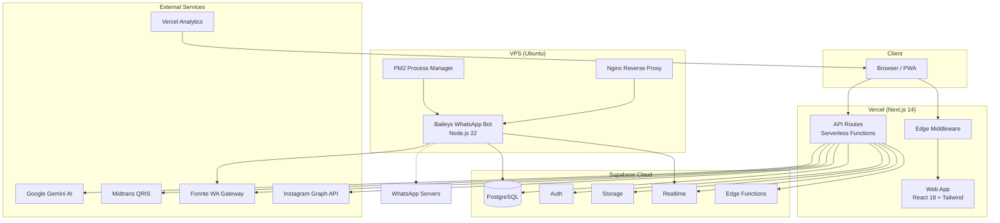

# Architecture Overview

## High-Level Diagram



## Component Responsibilities

| Component | Technology | Responsibility |
|-----------|------------|----------------|
| **Web App** | Next.js 14 App Router, React 18, Tailwind CSS | SSR/ISR pages, client components, PWA |
| **API Routes** | Next.js Route Handlers | Business logic, auth, payments, moderation, webhooks |
| **Edge Middleware** | Next.js Middleware | Security headers, canonical redirects, rate limit headers |
| **PostgreSQL** | Supabase (PostgreSQL 15+) | Primary data store, 25+ tables |
| **Auth** | Supabase Auth | Admin login (OAuth + email/password), JWT |
| **Storage** | Supabase Storage | Listing images, receipts, avatars |
| **Realtime** | Supabase Realtime | Live updates for chat, notifications, admin |
| **WhatsApp Bot** | Baileys (Multi-device) | Broadcast, transaction sync, admin commands |
| **AI Moderation** | Gemini 2.5 Flash | Content safety, spam detection, risk scoring |
| **Payments** | Midtrans | QRIS generation, callback handling |
| **Instagram** | Graph API | Auto-publish listings, Menfess, DM bot |

## Data Flow: Create Listing

```mermaid
sequenceDiagram
    participant User
    participant Client as Next.js Client
    participant API as POST /api/listings
    participant Moderation as Moderation Pipeline
    participant DB as Supabase (Service Role)
    participant Bot as WA Bot
    participant IG as Instagram API

    User->>Client: Fill form + upload images
    Client->>API: POST {title, price, images, ...}
    API->>API: Rate limit + HMAC session verify
    API->>API: Zod validation + honeypot check
    API->>Moderation: Deterministic filter (keywords, price limits)
    alt Deterministic rejects
        Moderation-->>API: status=rejected
        API-->>User: Error: "Barang terlarang"
    else Deterministic passes
        Moderation->>Gemini: AI analysis (title, desc, image)
        alt AI rejects
            Gemini-->>API: status=rejected, risk_score
            API-->>User: Error: "Tidak lolos moderasi"
        else AI approves/pending
            Moderation-->>API: status=approved|pending
            API->>DB: Insert listing (bypass RLS)
            DB-->>API: listing created
            API-->>User: Success + listing data
            par Async distribution
                API->>Bot: wa_outbox insert
                Bot->>WhatsApp: Broadcast to groups
                API->>IG: Auto-publish to Katalog
                API->>Realtime: Push notifications
                API->>Subscribers: Category/keyword alerts
            end
        end
    end
end
```

## Security Model

```
┌─────────────────────────────────────────────────────────────┐
│                    DEFENSE IN DEPTH                         │
├─────────────────────────────────────────────────────────────┤
│  1. EDGE MIDDLEWARE                                         │
│     - CSP, X-Frame-Options, XSS Protection                 │
│     - Canonical domain redirect                             │
│     - Admin path guards                                     │
├─────────────────────────────────────────────────────────────┤
│  2. API LAYER                                               │
│     - Rate limiting (per IP)                                │
│     - HMAC session verification (timing-safe)               │
│     - Zod input validation                                  │
│     - Honeypot bot detection                                │
├─────────────────────────────────────────────────────────────┤
│  3. AUTHORIZATION                                           │
│     - Admin: Supabase Auth + RBAC (superadmin/province/uni)│
│     - Seller: HMAC cookie (30d), separate secret            │
│     - Service Role: Server-only, bypasses RLS               │
├─────────────────────────────────────────────────────────────┤
│  4. DATABASE (RLS)                                          │
│     - Anon key: SELECT only public data (active listings)  │
│     - Service Role: Full access (API routes only)           │
│     - Sensitive tables: NO anon policies (payments, etc.)  │
├─────────────────────────────────────────────────────────────┤
│  5. APPLICATION LOGIC                                       │
│     - Blacklist WA double-check (session + form)           │
│     - Synthetic ID rejection (email_*, google_*)           │
│     - Receipt hash deduplication (SHA-256)                 │
│     - AI moderation (deterministic + Gemini)               │
└─────────────────────────────────────────────────────────────┘
```

## Multi-Campus Architecture

All campus-specific configuration is centralized in `src/config/campus.ts`:

```typescript
// Single source of truth
export const campusConfig = {
  campuses: [
    { id: 'usu', name: 'Universitas Sumatera Utara', shortName: 'USU', ... },
    { id: 'polmed', name: 'Politeknik Negeri Medan', shortName: 'POLMED', ... },
  ],
  fees: { listing: 2000, bump: 2000, ... },
  branding: { siteName: 'Kampus Kita', themeColor: '#16a34a', ... },
  whatsapp: { mainGroupId: '...', broadcastGroups: [...] },
  features: { freeMode: true, distributorEnabled: true, ... },
}
```

**To fork for another campus**: Copy `campus.ts`, change values, deploy. No code changes needed.

## Deployment Architecture

| Environment | Web | Bot | Database |
|-------------|-----|-----|----------|
| **Production** | Vercel (Edge) | VPS (Ubuntu + Nginx + PM2) | Supabase Cloud |
| **Preview** | Vercel Preview Deployments | — | Supabase (same project) |
| **Local** | `npm run dev` (localhost:3000) | `bot-wa/` optional | Supabase Local / Cloud |

## Scaling Considerations

| Component | Current | Scaling Strategy |
|-----------|---------|------------------|
| Web API | Vercel Serverless | Auto-scales, max 1000 concurrent |
| Database | Supabase (shared) | Upgrade to dedicated, read replicas |
| Realtime | Supabase Realtime | Connection pooling, sharding by campus |
| WhatsApp Bot | Single VPS | Multiple bot instances + Redis queue |
| AI Moderation | Gemini API | Batch processing, caching |
| Image Storage | Supabase Storage | Cloudflare R2 (configured, optional) |

## Monitoring & Observability

- **Vercel Analytics**: Web vitals, page views
- **Vercel Speed Insights**: Core Web Vitals
- **Supabase Logs**: PostgreSQL, Auth, Storage, Realtime
- **PM2 Monitoring**: `pm2 monit`, custom health endpoint
- **Error Tracking**: Console errors → Supabase `error_logs` table
- **Audit Trail**: `admin_audit_events` for all admin actions

## Technology Decisions (ADR Log)

| Decision | Rationale | Date |
|----------|-----------|------|
| Next.js 14 App Router | Best React SSR/ISR, Edge middleware, Server Components | 2024 |
| Supabase over raw PostgreSQL | Auth, Storage, Realtime, Edge Functions, Dashboard | 2024 |
| Baileys over WhatsApp Business API | Free, multi-device, full control, no per-message cost | 2024 |
| Gemini 2.5 Flash | Best price/performance for moderation, structured output | 2024 |
| HMAC cookies over JWT | Simpler, no key rotation complexity, timing-safe | 2024 |
| RLS over application-level auth | Defense in depth, cannot be bypassed by buggy code | 2024 |
| TypeScript strict (planned) | Catch bugs at compile time, better DX | 2025 |

---

*Last updated: 2024-11-16*