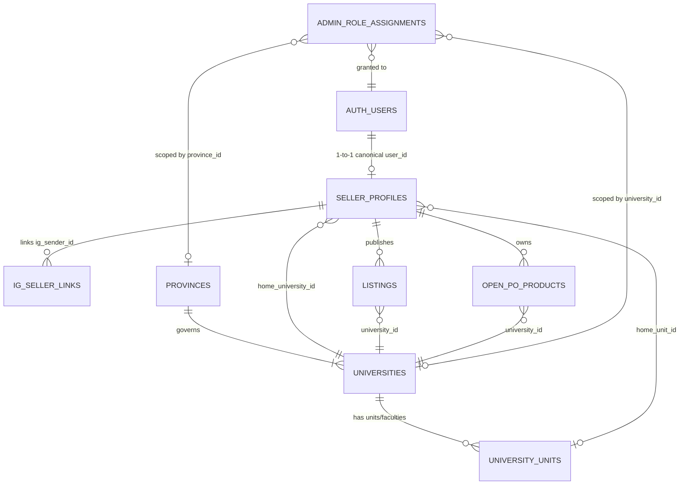

# Kebijakan & Arsitektur Nasionalisasi Identitas Pengguna (Universal User Identity)

> **Dokumen Kebijakan & Arsitektur Kanonikal Platform Kampus Kita**  
> Tanggal Disahkan: 2 November 2026  
> Status: **Aktif & Mengikat (Single Source of Truth)**  
> Referensi Terkait: `PROJECT_KNOWLEDGE.md`, `supabase/migrations/20261102150000_national_organization_rbac_requests.sql`, `docs/rencana-ig-dm-jual.md`

---

## 1. Latar Belakang & Urgensi

Struktur organisasi multi-tenant nasional (`provinces`, `universities`, `university_units`, `admin_role_assignments`) telah berhasil dibangun untuk lapisan tata kelola administratif. Namun, identitas akun pengguna biasa (pembeli dan penjual) secara historis masih bertumpu pada lapisan warisan (*legacy layer*) berbasis nomor WhatsApp, pencocokan teks `student_campus`, dan penautan ad-hoc Google/Instagram.

Agar platform siap melayani jutaan mahasiswa dan komunitas kampus di seluruh Indonesia tanpa fragmentasi data, diperlukan penyatuan arsitektur identitas pengguna yang seragam, aman, dan berpegang pada prinsip integritas data.

---

## 2. Tujuh Pilar Kebijakan Nasionalisasi Identitas Pengguna

### Pilar 1: Satu Akun Pengguna untuk Seluruh Indonesia (Universal Canonical Identity)
- Setiap pengguna hanya memiliki **satu identitas kanonikal** (`auth_user_id` yang merujuk pada `auth.users(id)`).
- Login Google dan nomor WhatsApp terverifikasi adalah **metode masuk (*authentication factors*)** yang ditautkan ke akun yang sama, bukan akun terpisah.
- Pindah kampus, berpindah kota, atau menambah afiliasi **tidak membuat akun baru**; riwayat transaksi, reputasi, dan kepemilikan listing tetap melekat pada identitas kanonikal pengguna.

### Pilar 2: Afiliasi Kampus Dipisahkan dari Identitas Akun
- Setiap pengguna berhak memilih **kampus komunitas utama** (`home_university_id`), namun pemilihan kampus ini tidak otomatis menyatakan bahwa yang bersangkutan adalah mahasiswa aktif terverifikasi.
- Status hubungan institusional disimpan secara terpisah dan eksplisit:
  1. `self_selected`: Pengguna umum/komunitas yang memilih kampus sebagai preferensi wilayah/pasar.
  2. `pending_verification`: Sedang mengajukan verifikasi mahasiswa (menunggu verifikasi email kampus atau peninjauan KTM).
  3. `verified_student`: Mahasiswa aktif terverifikasi (memperoleh lencana centang biru *Mahasiswa Terverifikasi*).
  4. `alumni`: Alumni terverifikasi dari kampus bersangkutan.
  5. `faculty_staff`: Dosen/tenaga kependidikan kampus.

### Pilar 3: Email Kampus Bukan Syarat Memakai Marketplace
- Marketplace Kampus Kita memegang prinsip **keterbukaan ekonomi kampus**: siapa pun dapat menjelajah, bertransaksi (COD/titip beli), dan memasang iklan reguler tanpa kewajiban memiliki email berakhiran `.ac.id`.
- Email kampus (`.ac.id`) berfungsi murni sebagai **instrumen verifikasi penambah kepercayaan (*trust & safety layer*)**, membuka akses lencana verifikasi, transaksi bernilai tinggi, atau program eksklusif mahasiswa, namun **tidak pernah menjadi penghalang (*blocker*)** untuk mendaftar dan berpartisipasi di marketplace.

### Pilar 4: Kampus Menjadi Sumber Wilayah Tunggal (Hierarki Deterministik)
- Wilayah provinsi dan hierarki regional **diturunkan otomatis secara deterministik** dari universitas yang dipilih:
  $$\text{Provinsi} = \text{universities.province\_id}$$
- Cabang kampus atau fakultas dicatat sebagai unit di bawah universitas (`public.university_units`).
- Tidak diperkenankan adanya pemilihan provinsi bebas yang berpotensi menghasilkan ketidakkonsistenan data (misal: memilih kampus USU namun memilih provinsi Jawa Timur).

### Pilar 5: Listing Mengikuti Identitas Organisasi Nasional
- Entitas iklan (`listings`, `wanted_listings`, `open_po_products`) mengacu secara kanonikal pada `university_id` dari katalog resmi `public.universities`.
- Kolom teks lama `campus` dipertahankan sementara untuk kompatibilitas ke belakang (*backward compatibility*) dan fallback mesin pencari, namun nilai kanonikalnya disinkronkan otomatis dengan kode universitas.
- Distribusi omnichannel (Instagram DM, bot WhatsApp, feed lokal) menyaring konten berdasarkan `university_id` dan `province_id` yang terpetakan secara presisi.

### Pilar 6: Afiliasi Kampus Bukan Hak Akses Admin (Strict Decoupling of Privileges)
- Status mahasiswa aktif, kepemilikan email kampus, maupun status penjual terverifikasi **sama sekali tidak memberikan hak administratif**.
- Hak akses pengelolaan admin provinsi atau kampus diatur secara terpisah, ketat, dan eksplisit melalui tabel `admin_role_assignments` dan `admin_scope_grants` yang hanya dapat dimandatkan oleh `superadmin`.

### Pilar 7: Migrasi Akun Hati-hati & Bersih (Anti-Vibe / Zero Assumption)
- Penggabungan akun lama (*profile merging*) **hanya dilakukan jika terdapat kecocokan identitas pasti (*exact cryptographic match*)**:
  - Nomor WhatsApp yang terbukti sama melalui normalisasi `formatWa`.
  - Akun Google dengan email yang sama persis hasil pertukaran token resmi OAuth.
- **Dilarang keras menebak atau menggabungkan akun berdasarkan kesamaan nama**.
- Jika data kampus lama ambigu (misal bernilai `LAINNYA` atau kosong), pengguna dipersilakan memilih universitas dari katalog resmi pada sesi berikutnya; sistem tidak boleh menetapkan kampus secara acak.

---

## 3. Resolusi Keamanan Kritis: Sanitasi Log Instagram DM (Tuntas)

Sesuai audit keamanan sebelum alur penautan akun diperluas ke Instagram DM:
- **Masalah Teridentifikasi**: Log DM masuk sebelumnya menyimpan teks mentah (`rawText`), yang berisiko mencatat kode OTP 6-digit atau kata sandi saat pengguna berada di langkah verifikasi nomor WhatsApp atau pembuatan kata sandi web.
- **Tindakan Perbaikan yang Telah Diterapkan**:
  1. Menambahkan fungsi sanitasi pertahanan ganda `sanitizeDmMessageText()` pada `src/lib/instagramDmLogger.js`.
  2. Mencegat dan menyamarkan teks menjadi `[REDACTED_CREDENTIAL]` pada langkah pengisian sensitif (`jual_ask_password`, `jual_ask_otp`, `jual_set_password`) langsung di `src/lib/instagramDmRouter.js`.
  3. Menyaring pola digit OTP mandiri (4–8 digit) dan frasa OTP/PIN/Password di seluruh panggilan log.
  4. Seluruh 6 unit test keamanan pada `__tests__/instagramDmLogger.test.js` lulus 100%.
  5. Seluruh log historis sensitif di database produksi telah dibersihkan menjadi `[REDACTED_OTP]`.

---

## 4. Diagram Arsitektur Identitas Nasional

---

## 5. Rencana Penerapan Bertahap (Roadmap)

1. **Fase 1 (Selesai)**: Struktur data organisasi nasional (`provinces`, `universities`, `university_units`, `admin_role_assignments`) dan sanitasi keamanan log DM.
2. **Fase 2 (Berikutnya)**: Penambahan kolom kanonikal `user_id uuid references auth.users(id)` dan `home_university_id text references public.universities(id)` pada `seller_profiles` secara non-breaking.
3. **Fase 3**: Pemutakhiran alur login Google dan verifikasi nomor WhatsApp untuk menautkan `user_id` secara deterministik ke `seller_profiles`.
4. **Fase 4**: Penyelarasan modul verifikasi mahasiswa (`src/lib/studentVerification.js` & `/api/student/verify`) agar mencatat `verified_university_id` resmi dari katalog.
5. **Fase 5**: Pemutakhiran UI profil pengguna (`UnifiedProfilePanel.jsx`) untuk menampilkan pemilihan kampus berbasis katalog nasional dengan pencarian cerdas.
